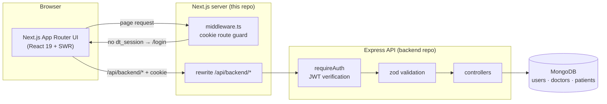
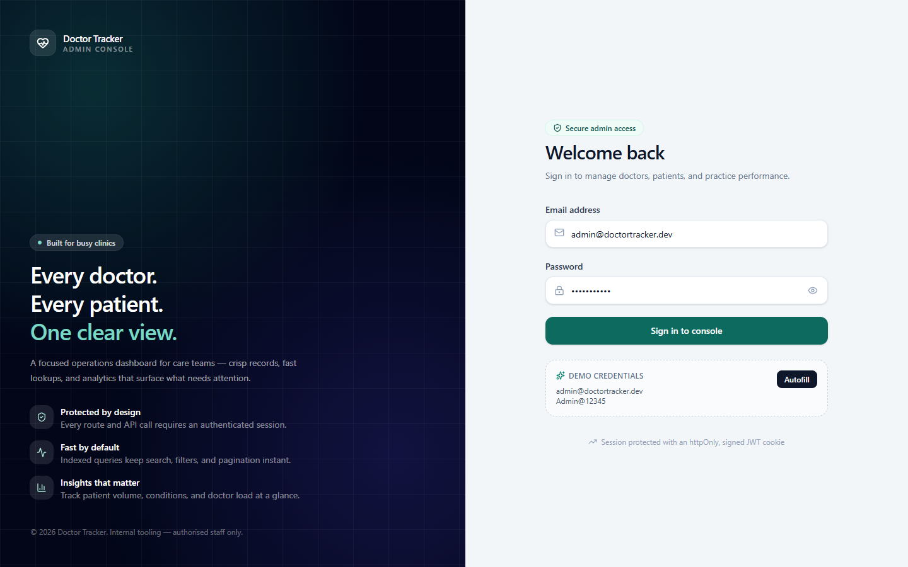
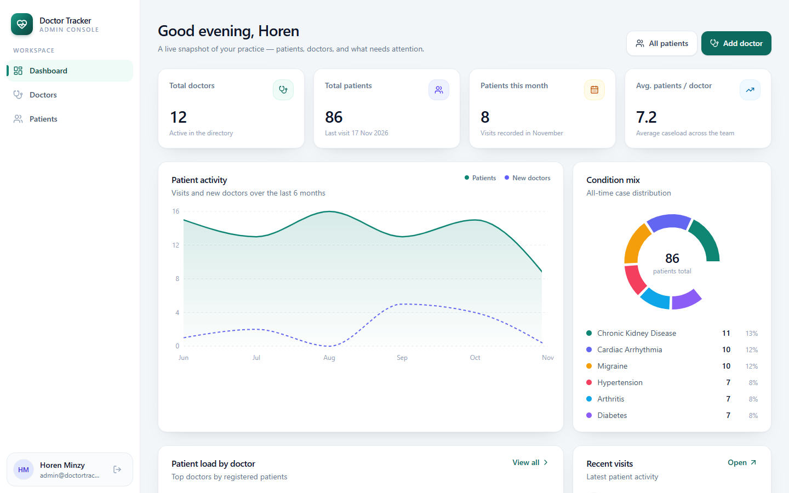
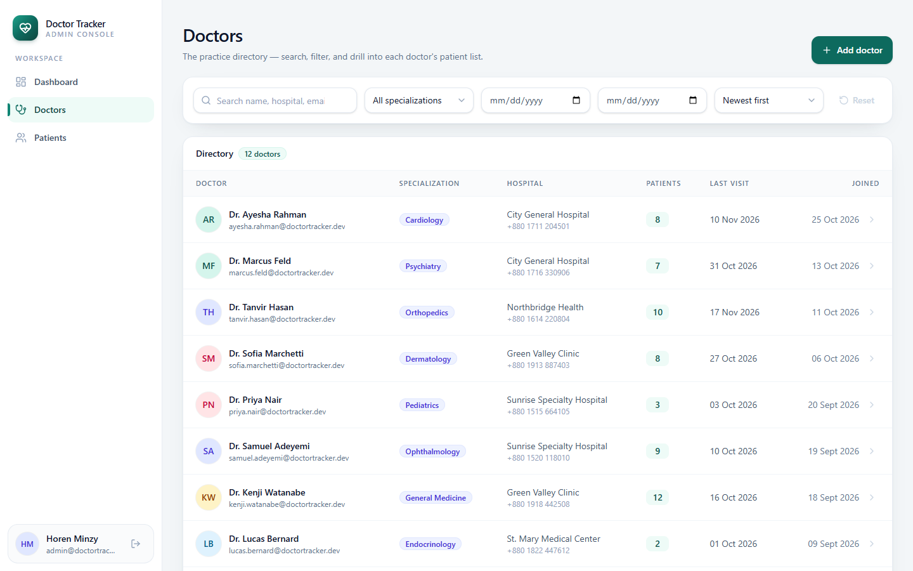
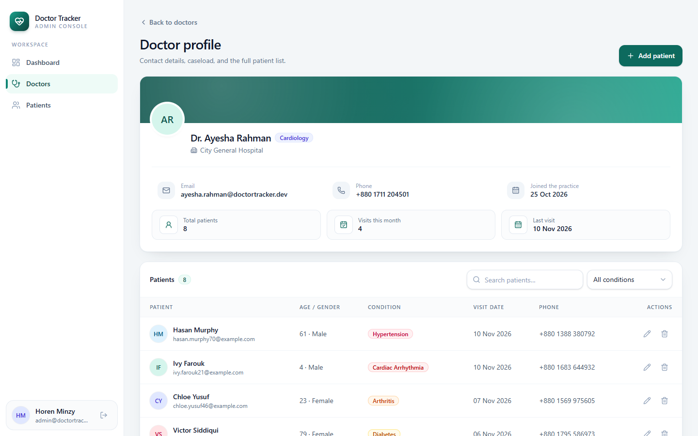
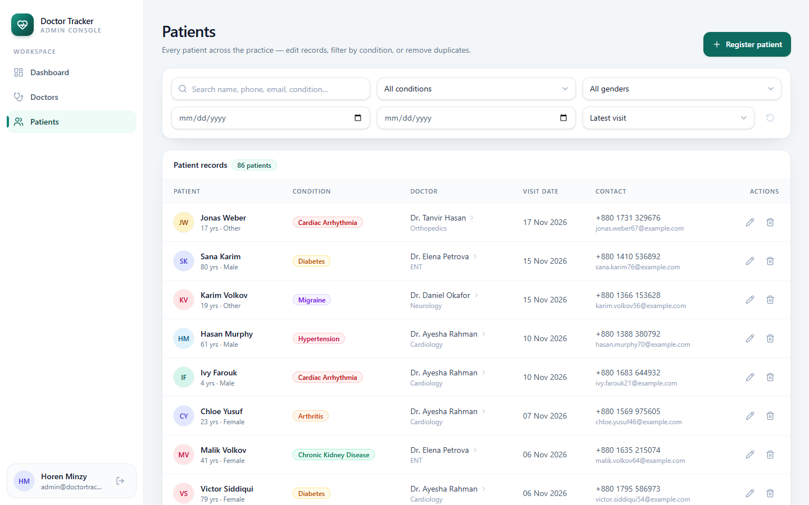
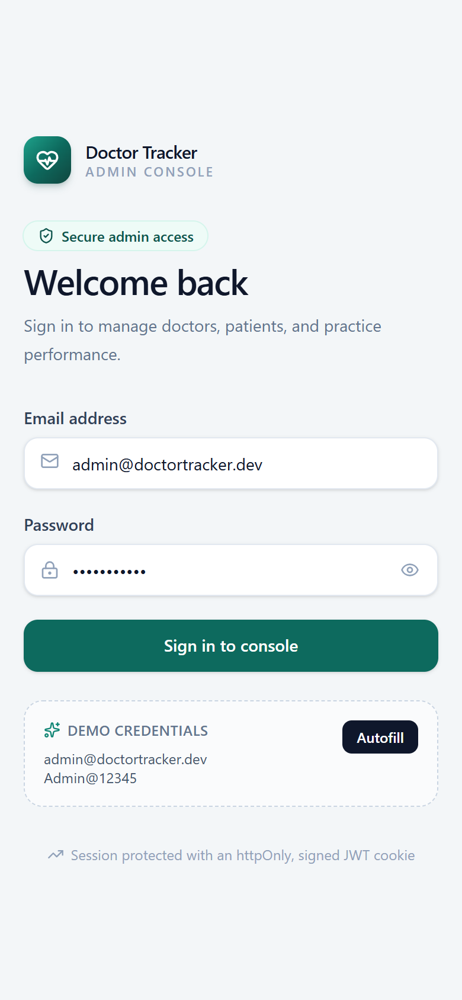
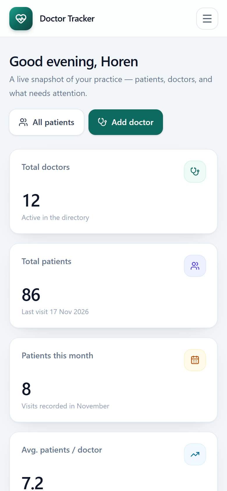
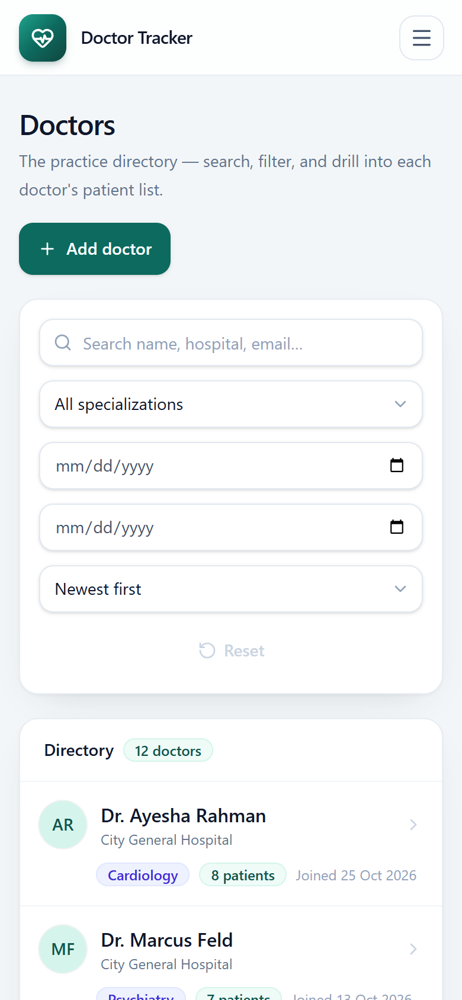
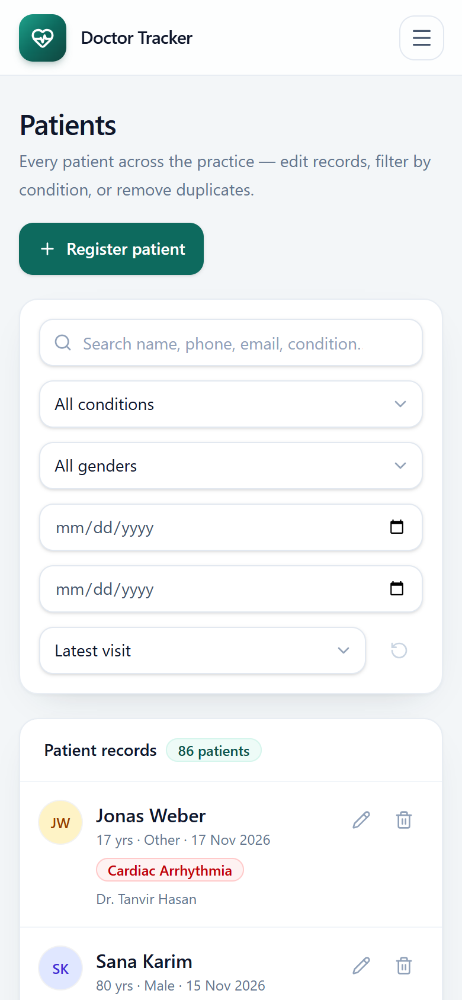

# Doctor Tracker — Admin Console

A secure admin console for small clinics and practices. Doctor Tracker keeps a searchable directory of doctors, manages the patients registered under each one, and turns the whole caseload into a live dashboard with trends, condition mix, and doctor workload — behind a single authenticated door.

**Repositories**

- **Frontend (this repository):** [doctor-tracker-client](https://github.com/horenminjee31-dev/doctor-tracker-client)
- **Backend API:** [doctor-tracker-api](https://github.com/horenminjee31-dev/doctor-tracker-api)

**Stack:** Next.js 15 (App Router, TypeScript, Tailwind CSS v4, SWR, Recharts) · [Express 4 REST API](https://github.com/horenminjee31-dev/doctor-tracker-api) · MongoDB + Mongoose · JWT in an httpOnly cookie.

---

## Contents

- [Demo credentials](#demo-credentials)
- [Description](#description)
- [Setup guide](#setup-guide)
- [System architecture](#system-architecture)
- [Technical decisions](#technical-decisions)
- [Testing](#testing)
- [Deployment](#deployment)
- [Visual evidence](#visual-evidence)

---

## Demo credentials

| Field | Value |
| --- | --- |
| Email | `admin@doctortracker.dev` |
| Password | `Admin@12345` |

The seeded database contains **12 doctors** and **86 patients** spread across the last six months so every chart, filter, and pagination control has meaningful data on first load.

---

## Description

Doctor Tracker is a full-stack admin application built around three screens and one rule: **nothing loads without a valid session**.

- **Dashboard** — total doctors, total patients, visits this month, average caseload per doctor, a six-month visit/new-doctor trend, a condition distribution chart, a doctor workload chart, and the five most recent visits. Everything comes from one API call.
- **Doctors** — create doctors (name, specialization, hospital, phone, email), search across name/hospital/email, filter by specialization and join date, sort, and paginate. Each row opens a doctor profile showing contact details, lifetime and monthly visit counts, and that doctor's patient list.
- **Doctor profile** — add a patient directly under the doctor, edit or delete any patient in the list, and search/filter within the doctor's own caseload.
- **Patients** — a practice-wide patient registry with search (name, phone, email, condition), filters for condition, gender, and visit-date range, sorting, and pagination. Patients can be edited or deleted in place; new patients are registered by picking the responsible doctor first.

The UI is a custom Tailwind design system (cards, badges, modals, toasts, skeletons, empty/error states) that collapses to a mobile layout with drawer navigation, stacked filters, and card-based records.

---

## Setup guide

### Prerequisites

- Node.js **20+**
- The [backend repository](https://github.com/horenminjee31-dev/doctor-tracker-api) running locally
- MongoDB — a local `mongod`, MongoDB Atlas, or the in-memory database bundled with the backend

### 1. Clone and install both repositories

```bash
git clone https://github.com/horenminjee31-dev/doctor-tracker-client.git
git clone https://github.com/horenminjee31-dev/doctor-tracker-api.git

cd doctor-tracker-client && npm install
cd ../doctor-tracker-api && npm install
```

### 2. Configure and start the API

```bash
cd doctor-tracker-api
cp .env.example .env    # set JWT_SECRET (32+ chars) and MONGODB_URI
```

| Variable | Default | Purpose |
| --- | --- | --- |
| `PORT` | `5000` | API port |
| `MONGODB_URI` | `mongodb://127.0.0.1:27017/doctor_tracker` | Database connection string |
| `JWT_SECRET` | — | Signing key, **required**, at least 32 characters |
| `JWT_EXPIRES_IN` | `8h` | Session lifetime |
| `CLIENT_ORIGIN` | `http://localhost:3000` | CORS allowlist (comma-separated) |
| `COOKIE_SAMESITE` | `lax` when empty | Cookie same-site policy |
| `COOKIE_SECURE` | `false` | Set `true` over HTTPS |
| `TRUST_PROXY` | — | Set `1` behind a proxy |

No local MongoDB? Start the bundled ephemeral instance in a separate terminal:

```bash
cd doctor-tracker-api
npm run dev:db
```

Data is lost when that process stops — reseed after restarting it.

### 3. Configure the frontend

```bash
cd doctor-tracker-client
cp .env.example .env.local
```

| Variable | Default | Purpose |
| --- | --- | --- |
| `API_PROXY_TARGET` | `http://127.0.0.1:5000` | Where Next.js rewrites `/api/backend/*` |
| `NEXT_PUBLIC_API_URL` | unset | Optional direct API base; leave unset for the supported proxy setup |

The browser calls `/api/backend/*` on the Next.js origin, Next proxies to Express, and the session cookie stays first-party.

### 4. Seed the database

```bash
cd doctor-tracker-api
npm run seed
```

The seed is idempotent: it upserts the admin user and replaces doctors/patients with the demo dataset.

### 5. Run

```bash
# terminal 1
cd doctor-tracker-api && npm run dev     # http://localhost:5000

# terminal 2
cd doctor-tracker-client && npm run dev  # http://localhost:3000
```

Open `http://localhost:3000` and sign in with the [demo credentials](#demo-credentials).

### Production build

```bash
cd doctor-tracker-client
npm run build
npm start
```

### Scripts

| Repository | Script | What it does |
| --- | --- | --- |
| this repo | `npm run dev` | Next.js dev server |
| this repo | `npm run build` / `npm start` | Production build / serve |
| this repo | `npm run lint` | ESLint (Next.js config) |
| API repo | `npm run dev` | Nodemon API server |
| API repo | `npm start` | Production API server |
| API repo | `npm run seed` | Upsert admin + reset demo data |
| API repo | `npm run smoke` | 21-check API suite against in-memory MongoDB |
| API repo | `npm run dev:db` | Ephemeral in-memory MongoDB on port 27017 |

---

## System architecture



### Request lifecycle

1. **Edge middleware** (`src/middleware.ts`) checks for the `dt_session` cookie on every non-asset route. Missing → redirect to `/login?next=…`; a logged-in user hitting `/login` → `/dashboard`.
2. **API guard** (`requireAuth` in the [backend](https://github.com/horenminjee31-dev/doctor-tracker-api)) verifies the signed JWT, loads the admin user, and attaches `req.user`. Only login, logout, and health are public.
3. **Validation** — zod schemas parse bodies, queries, and params before controllers run; invalid input returns `422` with field-level details the client maps onto form fields.
4. **Client data layer** — SWR keys mirror the API query string (`/patients?q=…&condition=…&page=2`), so filters and pagination keep previous data while revalidating. A non-auth `401` fires `auth:expired`, clearing the session and returning to `/login`.

### Frontend structure

```
src/
├── app/
│   ├── (app)/              # authenticated shell: dashboard, doctors, patients
│   ├── login/              # split-panel sign-in
│   ├── layout.tsx          # fonts, metadata, providers
│   └── globals.css         # Tailwind v4 theme tokens
├── components/
│   ├── ui/                 # buttons, fields, modal, badge, pagination, skeletons
│   ├── dashboard/          # Recharts trend, donut, and workload charts
│   ├── doctors/            # doctor creation modal
│   ├── patients/           # patient form + doctor picker modals
│   ├── providers/          # SWR, auth, and toast providers
│   └── shell/              # sidebar, mobile drawer, navigation
├── lib/                    # API client, types, formatters, hooks
└── middleware.ts           # cookie-based route protection
```

### API surface

All routes are prefixed with `/api` and served by the backend repository.

| Method | Endpoint | Notes |
| --- | --- | --- |
| `POST` | `/auth/login` | Rate-limited; sets the httpOnly cookie |
| `POST` | `/auth/logout` | Clears the cookie |
| `GET` | `/auth/me` | Current admin profile |
| `GET` / `POST` | `/doctors` | List (search, filters, sort, page) / create |
| `GET` | `/doctors/:id` | Profile + caseload summary |
| `GET` / `POST` | `/doctors/:doctorId/patients` | Doctor's patients / add a patient |
| `GET` | `/patients` | Search, condition, gender, doctor, date range, sort, page |
| `PATCH` / `DELETE` | `/patients/:id` | Update / delete |
| `GET` | `/dashboard` | Summary, trend, condition mix, doctor load, recent visits |
| `GET` | `/meta` | Filter option lists |
| `GET` | `/health` | Liveness probe (public) |

### Security baseline

- Session JWT in an `HttpOnly`, `SameSite=Lax` cookie; the browser never reads the token.
- Route protection at two layers: edge middleware for navigation, `requireAuth` on every API route.
- Helmet, CORS allowlist with credentials, 100 kB body cap, 600 req/min API limiter, 20-attempt/15-min login limiter.
- bcrypt password hashes, uniform login errors, server-side pagination caps, regex-escaped search.

---

## Technical decisions

### 1. Session handling: signed JWT in an httpOnly cookie behind a same-origin proxy

**Decision.** Login issues a short-lived (8 h) signed JWT stored in an `HttpOnly`, `SameSite=Lax` cookie named `dt_session`. The browser never reads the token. The client calls `/api/backend/*`, which Next.js rewrites to the Express API, keeping the cookie first-party.

**Why not `localStorage` + `Authorization: Bearer`?** That pattern is easy to wire across origins, but any successful XSS can exfiltrate the token, and every request needs custom header plumbing. With an httpOnly cookie, injected scripts can trigger requests but cannot copy the session. The trade-off is CSRF exposure; we mitigate it with `SameSite=Lax`, the same-site proxy, and server-side auth checks. For a multi-domain deployment, `COOKIE_SAMESITE=none` + `COOKIE_SECURE=true` are available, with a double-submit CSRF token as the next hardening step.

**Defense in depth.** Edge middleware performs the fast redirect for unauthenticated navigation; every controller sits behind `requireAuth`. Deleting the cookie bypasses the redirect but not the API. `AuthProvider` validates the session with `/auth/me` and listens for `auth:expired`, so an expired cookie produces a clean return to `/login?next=…`. Logout clears the cookie server-side and the SWR cache client-side.

**Alternatives considered.** Server-side sessions in Redis would enable instant revocation at the cost of infrastructure and a round-trip per request. Refresh-token rotation extends sessions safely but is overkill for an 8-hour internal admin tool. The chosen design keeps the API stateless and horizontally scalable.

### 2. Query strategy: compound indexes, batched aggregation, and offset pagination

**Decision.** Reads are shaped around the three access patterns the UI actually performs, and each has index support:

| Screen | Access pattern | Index / technique |
| --- | --- | --- |
| Doctors list | specialization + newest first | `{ specialization: 1, createdAt: -1 }` |
| Doctors list | join-date range | `{ createdAt: -1 }` |
| Doctor profile | doctor's patients, newest visit first | `{ doctor: 1, visitDate: -1 }` |
| Patients page | condition + visit range | `{ condition: 1, visitDate: -1 }` |
| Patients page | global visit range / recency | `{ visitDate: -1 }`, `{ createdAt: -1 }` |

`find()` and `countDocuments()` run in parallel with the same filter, and each doctor row's patient count comes from **one** aggregation (`$match { doctor: { $in: ids } }` → `$group`) instead of a query per doctor — avoiding N+1 while keeping the doctor document free of counters that would need invalidation on every patient write.

**Dashboard in one round-trip.** Totals, this month, six-month trend, condition distribution, doctor workload, and recent visits are computed by two parallel aggregations (patients and doctors), each using `$facet` to scan once and emit independent metrics. `$lookup` resolves doctor names inside the pipeline, and empty months are filled in JavaScript so the chart always has six points. Dashboard latency stays flat as data grows, without a chatty client.

**Pagination.** The API uses `skip`/`limit` with page-number metadata (`total`, `pages`, `hasNext`, `hasPrev`) because the UI needs jump-to-page and stable counts; `limit` is clamped to 50. The known cost is deep-page scanning: `skip(1000)` still walks skipped index entries. At this scale that is irrelevant, but it is the first thing to change at tens of thousands of rows — the page buttons map cleanly onto a cursor (`visitDate` + `_id`) API, trading random access for constant-time reads.

**Search.** Free-text search is a case-insensitive, regex-escaped substring match across the fields that matter per screen. This gives the expected admin-tool behavior; the trade-off is that a leading-wildcard regex cannot use a B-tree index, so it scans the collection (bounded by pagination and small clinic datasets). A MongoDB text index or Atlas Search is the upgrade path for relevance-ranked, index-backed search.

---

## Testing

```bash
npm run build     # type-check + production compile
npm run lint
```

The API repository ships a 21-check end-to-end smoke suite (`npm run smoke` in the backend repo): authentication, cookie issuance, validation and duplicate errors, search/filter/pagination, sorting, nested patient operations, update/delete consistency, dashboard shape, logout, and post-logout access denial.

The UI was verified manually on desktop (1440×900) and mobile (390×844): sign-in, logout, direct-URL protection, doctor search/creation, patient registration from both entry points, edit/delete flows, filters, and pagination.

---

## Deployment

The supported topology is **Vercel (this repo) → Render (API repo) → MongoDB Atlas**.

1. Deploy the API repository to Render using its `render.yaml` blueprint and connect MongoDB Atlas. Set `CLIENT_ORIGIN` to the Vercel URL, `COOKIE_SECURE=true`, `COOKIE_SAMESITE=lax`, `TRUST_PROXY=1`.
2. Seed the hosted database once: `npm run seed` against the Atlas URI (details in the backend README).
3. Import this repository into Vercel, set the environment variable `API_PROXY_TARGET=https://<api-service>.onrender.com`, and deploy.
4. Do **not** set `NEXT_PUBLIC_API_URL` — the browser must keep using `/api/backend/*` so the cookie stays first-party and the route guard works.
5. Verify: `curl https://<api>/api/health`, then sign in, hard-refresh `/dashboard`, and sign out in a private window.

`API_PROXY_TARGET` is read while `next.config.ts` is evaluated at build time, so changing it requires a redeploy.

---

## Visual evidence

### Desktop — 1440 × 900

**Sign in**



**Dashboard**



**Doctors directory**



**Doctor profile and patient list**



**Patients registry**



### Mobile — 390 × 844

| Sign in | Dashboard |
| --- | --- |
|  |  |

| Doctors | Patients |
| --- | --- |
|  |  |
